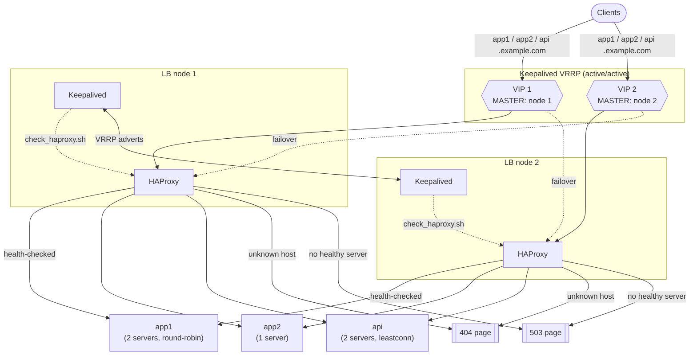

# HAProxy + Keepalived HA load balancer

[](LICENSE)

A production-style template for a **two-node, highly available HAProxy load
balancer** with **Keepalived (VRRP) floating IPs**, plus a `docker compose`
demo you can run on a laptop to watch load balancing, health checks, custom
error pages, the stats page and VIP failover in action.

What you get:

- **Active/active VRRP**: two virtual IPs, each node is MASTER of one and
  BACKUP of the other. If HAProxy dies on a node, its VIP moves to the peer in
  ~2–4 s and moves back (preempt) when the node recovers.
- **HAProxy 3.x** config: TLS termination (TLS 1.2+, HTTP/2), HTTP→HTTPS
  redirect, host-based routing, layer-7 health checks, round-robin /
  least-conn / sticky sessions, HTTPS re-encryption with SNI, multi-origin
  CORS, security headers, SNI-based TCP passthrough (e.g. Kubernetes API),
  custom 404/503 pages, stats page with viewer/admin users, Prometheus exporter.
- **Bare-metal files** ready for `/etc`: HAProxy, Keepalived (node 1 / node 2),
  track script, systemd unit, rsyslog (one log file per virtual host),
  logrotate, sysctl.
- **Docs**: [architecture & design decisions](docs/architecture.md) and a
  step-by-step [installation guide](docs/installation.md) (build HAProxy from
  source on a RHEL-family distro, firewall, certificates, logging, Keepalived).

## Architecture



## Quick start (Docker demo)

Requirements: Docker with Compose v2. The demo uses its own bridge network
`10.77.0.0/24` (change it in `docker-compose.yml` if it collides with yours).

```bash
cp .env.example .env          # optional: change stats credentials
docker compose up -d --build
docker compose ps             # lb1 / lb2 should become "healthy"
```

Run the smoke test from the client container (it lives on the same network
as the VIPs `10.77.0.100` and `10.77.0.101`):

```bash
docker compose exec client sh /scripts/smoke-test.sh
```

```text
== Round robin on app1 through VIP1 ==
app1.example.com   via 10.77.0.100  -> HTTP 200  lb=lb1  backend=app1-a
app1.example.com   via 10.77.0.100  -> HTTP 200  lb=lb1  backend=app1-b
...
== Least-conn on api through VIP2 ==
api.example.com    via 10.77.0.101  -> HTTP 200  lb=lb2  backend=api-1
...
== Unknown host -> custom 404 ==
unknown.example.com via 10.77.0.100  -> HTTP 404
== HTTP -> HTTPS redirect ==
http://app1.example.com -> 301 https://app1.example.com/
```

From the host, each node is also published directly:

| What | lb1 | lb2 |
|---|---|---|
| HTTPS | `https://localhost:8443` | `https://localhost:9443` |
| HTTP (redirects) | `http://localhost:8080` | `http://localhost:9080` |
| Stats page | <http://localhost:8404/stats> | <http://localhost:9404/stats> |
| Prometheus metrics | <http://localhost:8405/metrics> | <http://localhost:9405/metrics> |

```bash
curl -k --resolve app1.example.com:8443:127.0.0.1 https://app1.example.com:8443/
```

### Try the failure scenarios

```bash
# 1) Backend failure -> health check marks it DOWN -> custom 503 page
docker compose stop app2-a
docker compose exec client curl -sk --resolve app2.example.com:443:10.77.0.100 https://app2.example.com/ -o /dev/null -w '%{http_code}\n'   # 503
docker compose start app2-a

# 2) Load balancer failure -> VIP 1 moves from lb1 to lb2
docker compose exec lb1 pkill haproxy
docker compose logs lb1 lb2 | grep STATE       # (VI_1) Entering MASTER STATE on lb2
docker compose exec client curl -sk --resolve app1.example.com:443:10.77.0.100 https://app1.example.com/ -D - -o /dev/null | grep -i x-lb-node   # lb2

# 3) Recovery -> lb1 preempts VIP 1 back
docker compose restart lb1

# Drain a server from the stats page (log in with the *admin* user) or the runtime API:
docker compose exec lb1 sh -c 'echo "set server app1_backend/app1-a state drain" | socat stdio /var/run/haproxy.sock'
```

Clean up: `docker compose down -v`.

> The demo runs HAProxy and Keepalived in the same container (with
> `NET_ADMIN`) only to keep it self-contained. In production they are two
> systemd services on each VM, configured with the files in `bare-metal/`.

## Repository layout

```text
.
├── docker-compose.yml           # demo: lb1, lb2, 5 whoami backends, client
├── .env.example                 # stats credentials for the demo
├── demo/
│   ├── Dockerfile               # alpine + haproxy + keepalived
│   ├── entrypoint.sh
│   ├── haproxy/haproxy.cfg      # demo config (shared by both nodes)
│   └── keepalived/              # lb1.conf, lb2.conf, check_haproxy.sh
├── bare-metal/                  # drop-in files for real servers (mirror /)
│   ├── etc/haproxy/haproxy.cfg
│   ├── etc/haproxy/errors/      # 404.html, 503.html (also used by the demo)
│   ├── etc/keepalived/          # keepalived-node1.conf, keepalived-node2.conf, check_haproxy.sh
│   ├── etc/rsyslog.d/           # haproxy.conf (per-host logs), keepalived.conf
│   ├── etc/logrotate.d/         # haproxy, keepalived
│   ├── etc/sysconfig/haproxy
│   ├── etc/sysctl.d/99-haproxy-vip.conf
│   └── usr/lib/systemd/system/haproxy.service
├── scripts/smoke-test.sh
└── docs/
    ├── architecture.md
    └── installation.md
```

## Configuration

### Publishing a new service

1. **ACL** in `frontend https_in`: `acl host_shop hdr(host) -i shop.example.com`
2. **503 rule** (optional): `http-request return status 503 content-type "text/html" lf-file /etc/haproxy/errors/503.html if host_shop { nbsrv(shop_backend) eq 0 }`
3. **Route**: `use_backend shop_backend if host_shop`
4. **Backend**: copy the commented template in `bare-metal/etc/haproxy/haproxy.cfg`,
   pick a balancing algorithm and a health check, list the servers.
5. `haproxy -c -f /etc/haproxy/haproxy.cfg && systemctl reload haproxy`
   (copy the file to **both** nodes).

### Key settings

| Setting | Where | Default | Notes |
|---|---|---|---|
| Health check cadence | `defaults` → `default-server` | `inter 5s rise 2 fall 3` | A server is DOWN after ~15 s of failures |
| VRRP advert interval | `advert_int` | `1` s | Peer declares MASTER dead after ~3 adverts |
| Track script | `vrrp_script chk_haproxy` | every 2 s, `fall 2`, `weight -100` | 150 − 100 = 50 < 100 → peer takes the VIP |
| Stats users | `userlist stats_viewers / stats_admins` | — | Viewers read-only; admins can drain/maint/ready |
| Admin allowlist | `acl admin_net src ...` | `10.0.100.0/24` | Stats, metrics, Cockpit |
| Certificates | `bind ... crt` | `/etc/haproxy/certs/*.pem` | PEM = cert + key + chain |

## How failover works

1. Each node runs Keepalived with two VRRP instances. Node 1 has priority 150
   on `VI_1` and 100 on `VI_2`; node 2 is the mirror image. The higher
   priority owns the VIP and sends an advertisement every second.
2. Every 2 s Keepalived runs `check_haproxy.sh` (`pidof haproxy`). After 2
   consecutive failures the script's `weight -100` lowers the node's priority
   to 50 on the instance it was MASTER for.
3. The peer (priority 100) now has the highest priority, becomes MASTER,
   adds the VIP to its interface and sends gratuitous ARP so switches/hosts
   update their tables. Clients reconnect to the same IP and hit the healthy node.
4. When HAProxy comes back (`rise 2`), the original node's priority returns to
   150 and it **preempts** the VIP back. Add `nopreempt` (with `state BACKUP`
   on both nodes) if you prefer the VIP to stay where it is.

Because both nodes bind every VIP (`transparent` + `net.ipv4.ip_nonlocal_bind=1`),
HAProxy does not need a reload when a VIP moves.

## Production notes

- **Same config on both nodes.** HAProxy config is identical; only the
  Keepalived file differs (priorities/state). Keep them in version control and
  deploy with your config management tool.
- **VRRP auth is not security.** `auth_type PASS` sends at most 8 characters
  in clear text; isolate VRRP traffic (dedicated VLAN or unicast peers +
  firewall) and allow protocol 112: `firewall-cmd --permanent --add-protocol=vrrp`.
- **Multicast filtered?** (clouds, some hypervisors) use `unicast_src_ip` /
  `unicast_peer`, as the demo does. In public clouds, VIPs usually require the
  provider's API (secondary IPs / route updates) via a `notify_master` script.
- **Track more than the process.** `pidof` catches crashes; for hangs, also
  query the runtime socket (see the commented line in `check_haproxy.sh`).
- **Passwords.** Use `password <sha512-crypt hash>` (`mkpasswd -m sha-512`)
  in userlists instead of `insecure-password`.
- **Upstream TLS.** `ssl verify none` re-encrypts without validating the
  backend certificate; use `verify required ca-file <ca.pem>` where possible.
- **Logs.** rsyslog writes one file per requested host under
  `/var/log/haproxy/hosts/<label>/<host>.log`; logrotate keeps 7 daily
  rotations with `copytruncate` (no daemon reload). Raise `rotate` for test
  environments where you want longer history.
- **Monitoring.** Scrape `/metrics` from both nodes (see the companion
  Prometheus + Thanos stack) and alert on `haproxy_backend_active_servers == 0`
  and on VIP ownership changes in the Keepalived log.
- **Reloads are hitless.** `systemctl reload haproxy` validates the config
  first (`-c`) and then sends `USR2` to the master process; `expose-fd listeners`
  keeps sockets open during the reload.

## License

[MIT](LICENSE) © Ericson López
