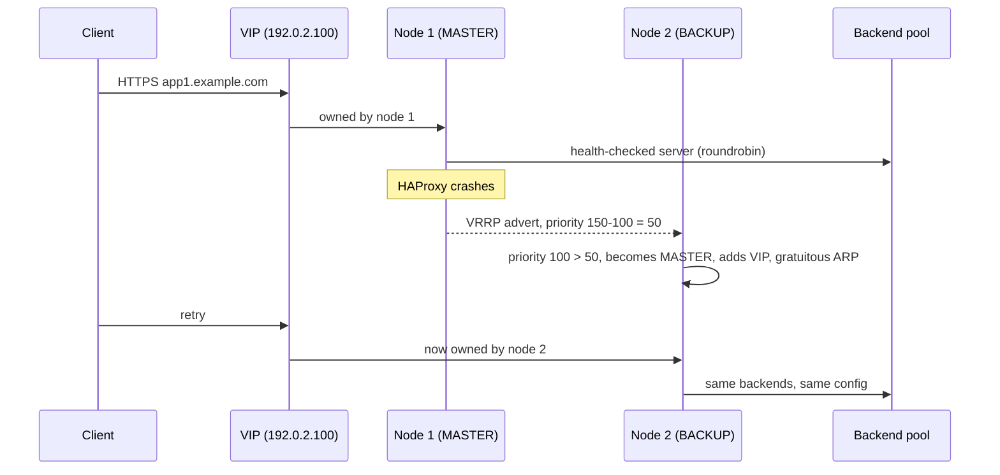

# Architecture and design decisions

This document explains how the two-node load-balancer cluster works, why each
component was chosen and how HAProxy, Keepalived, logging and error handling
fit together. File references point to [`bare-metal/`](../bare-metal).

## 1. Overview

- Two Linux nodes run HAProxy. Keepalived (VRRP) announces the virtual IPs
  (VIPs) according to node priority
  ([`keepalived-node1.conf`](../bare-metal/etc/keepalived/keepalived-node1.conf),
  [`keepalived-node2.conf`](../bare-metal/etc/keepalived/keepalived-node2.conf)).
- Keepalived's track script
  ([`check_haproxy.sh`](../bare-metal/etc/keepalived/check_haproxy.sh)) checks
  that HAProxy is running; if it is not, the node gives up its VIPs so there is
  no service gap.
- systemd starts HAProxy with the main file plus everything in `conf.d/`
  ([`haproxy.service`](../bare-metal/usr/lib/systemd/system/haproxy.service));
  extra flags are injected from
  [`/etc/sysconfig/haproxy`](../bare-metal/etc/sysconfig/haproxy).



## 2. Components and design rationale

### HAProxy
- **TLS**: built against OpenSSL; only TLS 1.2+ with strong ciphers, session
  tickets disabled. Every HTTPS VIP loads the certificate bundle and enables
  HTTP/2 (`alpn h2,http/1.1`).
- **Threads**: `nbthread 4` + `cpu-map` spread one process over 4 cores,
  balancing latency and efficiency without multiple processes.
- **Runtime API**: `stats socket /var/lib/haproxy/stats` lets operators change
  server states live (ready/drain/maint) and read metrics without exposing an
  HTTP endpoint.
- **Daemon + dedicated user**: runs as the unprivileged `haproxy` user.

### Keepalived (high availability)
- Two VRRP instances: `VI_1` (internal-facing VIP) and `VI_2` (public-facing
  VIP). Each node is MASTER of one and BACKUP of the other, which spreads load
  and still allows either node to carry everything (advert interval 1 s,
  priorities 150/100).
- The `-100` weight of `vrrp_script` drops the priority when HAProxy fails, so
  traffic moves to the healthy node.

### Logging and rotation
- HAProxy logs to the local syslog socket: `local0` for traffic, `local1` for
  notices. rsyslog extracts the requested host and writes one file per host:
  `/var/log/haproxy/hosts/{label}/{host}.log`
  ([`rsyslog.d/haproxy.conf`](../bare-metal/etc/rsyslog.d/haproxy.conf)).
- logrotate rotates daily, keeps 7 rotations, compresses and tolerates missing
  files ([`logrotate.d/haproxy`](../bare-metal/etc/logrotate.d/haproxy)).
- `option dontlognull` removes noise from probes and empty connections.

### Custom error pages
- Clear HTML pages for [404](../bare-metal/etc/haproxy/errors/404.html) and
  [503](../bare-metal/etc/haproxy/errors/503.html). They are served with
  `http-request return ... lf-file`, so `%[req.hdr(Host)]` is expanded and the
  user (or help desk) sees which host failed.
- The 503 page is returned automatically when **all** servers of a backend are
  down (`nbsrv(<backend>) eq 0`).

## 3. HTTP/HTTPS flow

1. `frontend http_in` listens on :80 and answers `301` to HTTPS.
2. `frontend https_in` listens on :443 on every VIP:
   - denies non-TLS traffic (`http-request deny if !{ ssl_fc }`);
   - captures `Host` for logging;
   - host ACLs choose the backend;
   - `http-request return ... 503.html` serves the maintenance page when a
     backend has no healthy server;
   - security headers (CSP, HSTS, X-Frame-Options, X-Content-Type-Options,
     Referrer-Policy, Permissions-Policy, CORP/COOP) are set **only if the
     backend did not set them** (`if !{ res.hdr(...) -m found }`), so
     individual applications can relax them;
   - the `Server` header is removed to reduce fingerprinting.
3. `default_backend not_found_backend` answers any unmapped host with the 404
   page instead of silently dropping it.

### Backends (HTTP)
- Each backend sets its mode, balancing algorithm (roundrobin, leastconn, ...),
  `option forwardfor` to preserve the client IP and `X-Forwarded-Proto` so the
  application knows the original request was HTTPS.
- Health checks: `option httpchk` + `http-check expect status 200` (layer 7)
  or `option tcp-check` (layer 4). They drive the automatic 503 rules.
- Optional stickiness with cookies (`cookie SERVERID insert indirect nocache`)
  for stateful applications.
- HTTPS upstreams are re-encrypted with `ssl sni str(<host>)` so servers that
  host several sites (e.g. IIS) pick the right certificate.
- CORS with several allowed origins: store the request `Origin` in a
  transaction variable and echo it back only when it matches the allowlist.

### TCP passthrough with SNI
- `frontend tcp_sni_passthrough` listens on :6443 and routes by SNI without
  terminating TLS, which preserves mutual-TLS client authentication (e.g. the
  Kubernetes API).

## 4. High availability with Keepalived

- `track_script chk_haproxy` guarantees that only a node with a working
  HAProxy keeps a VIP.
- Short intervals (`advert_int 1`, script every 2 s) give a failover of a few
  seconds under normal conditions.
- HAProxy binds every VIP on both nodes (`transparent`,
  `net.ipv4.ip_nonlocal_bind = 1`), so nothing needs to be reloaded when a VIP
  moves.

## 5. Logs and traceability

HAProxy → `/dev/log` (local0/local1) → rsyslog regex extracts the host →
per-host file. Searching per service no longer means grepping one huge file.
`copytruncate` means rotation never requires a daemon restart. Add more
`http-request capture` lines if you need extra fields in the log.

## 6. Operations

- `systemctl reload haproxy` runs `haproxy -c` first; an invalid config never
  replaces the running one.
- Files in `/etc/haproxy/conf.d/` are loaded too (`-f $CFGDIR`), which lets you
  split frontends/backends into modules.
- Useful commands:

```bash
haproxy -c -f /etc/haproxy/haproxy.cfg                    # validate config
keepalived -t -f /etc/keepalived/keepalived.conf          # validate keepalived
journalctl -u keepalived -b -n 200 | grep -E 'VI_|MASTER|BACKUP|FAULT'
ip -4 addr show dev eth0                                  # who owns the VIPs?
echo "show stat" | socat stdio /var/lib/haproxy/stats \
  | cut -d, -f1,2,5-11,18,24,27,30,36,50,37,56,57,62 | column -s, -t
```

## 7. Security summary

- Mandatory TLS, 301 redirect from HTTP.
- Strict CSP by default with per-backend overrides.
- HSTS for one year with `includeSubDomains` and `preload`.
- Anti-clickjacking, anti-sniffing, privacy and CORS headers.
- Stats, metrics and Cockpit restricted to an admin network and protected by
  user lists (viewer vs. admin).
- Generic error pages; upstream `Server`/`X-Powered-By` headers removed.

## 8. Extending

- **New host**: ACL in `https_in`, optional 503 rule, `use_backend` line, and a
  backend copied from the commented template.
- **New TCP/SNI service**: replicate the `tcp_sni_passthrough` pattern
  (`mode tcp`, `tcp-request inspect-delay`, `req_ssl_sni` ACLs).
- **New VIP**: add it to the right `vrrp_instance` on **both** nodes and add a
  `bind <vip>:443 transparent ssl ...` line in HAProxy.
